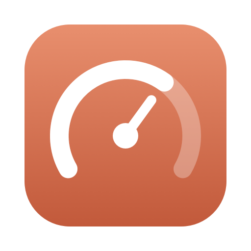

<p align="center"></p>

# Claude Usage Bar

[](https://github.com/LeoFalco/claude-usage-bar/actions/workflows/ci.yml)

A tiny macOS menu bar app that shows your Claude plan usage, the same numbers as `/usage` in Claude Code.

<p align="center"></p>

The menu bar shows `✳︎` followed by the highest session % and the highest weekly %. Click it for the panel:

- one bar per limit, orange at 70% and red at 90%;
- the countdown and the exact date and time each limit resets;
- **pace projection**: if usage keeps the average pace it has had since the window started, whether the limit lasts until reset, and roughly where it ends, or the date and time it runs out. It waits until 5% of the window has passed before guessing;
- refresh every 5 minutes, or right away with Refresh, ⌘R;
- the gear menu holds Open at login and Quit, ⌘Q.

## Install

```bash
curl -fsSL https://raw.githubusercontent.com/LeoFalco/claude-usage-bar/main/install.sh | bash
```

It downloads the latest release into `/Applications`, clears the quarantine flag, since the app is not notarized, and opens it. On first launch the app adds itself to Login Items, so it starts with your Mac; turn that off in the gear menu.

To install by hand, download `ClaudeUsageBar.zip` from the [latest release](https://github.com/LeoFalco/claude-usage-bar/releases/latest), move the app to `/Applications` and run `xattr -dr com.apple.quarantine /Applications/ClaudeUsageBar.app`.

Requires macOS 13+ and [Claude Code](https://docs.claude.com/en/docs/claude-code) logged in with a Claude subscription (`claude` then `/login`).

## How it works

Claude Code stores its OAuth credentials in your login Keychain (item `Claude Code-credentials`). The app reads the access token with `/usr/bin/security` and calls the same endpoint `/usage` uses:

```
GET https://api.anthropic.com/api/oauth/usage
Authorization: Bearer <token>
anthropic-beta: oauth-2025-04-20
```

The token never leaves your machine except in that request to Anthropic. The app does not refresh the token itself: if it shows "Token expired", run Claude Code once.

This endpoint is undocumented and may change; the app reads the `limits` list and falls back to the older `five_hour` and `seven_day` fields.

## Build from source

```bash
swift test                 # needs Xcode (XCTest)
scripts/bundle.sh          # builds dist/ClaudeUsageBar.app for this Mac
scripts/bundle.sh --arch arm64 --arch x86_64   # universal build (needs Xcode)
open dist/ClaudeUsageBar.app
swift scripts/make-icon.swift                  # redraws Resources/AppIcon.icns and docs/icon.png
swift build && .build/debug/ClaudeUsageBar --snapshot docs/screenshot.png   # redraws the screenshot with sample data
```

## Releases

CI runs tests and builds the app on every push to main and on every pull request. Pushing a tag `vX.Y.Z` builds a universal app and publishes it as a GitHub release.

## License

MIT. Not affiliated with Anthropic.
