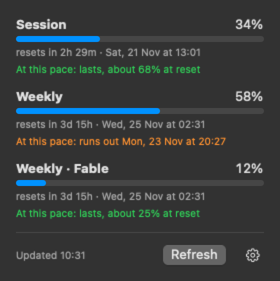
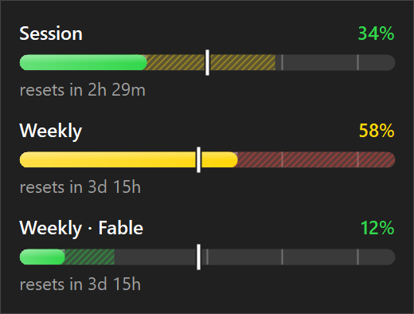
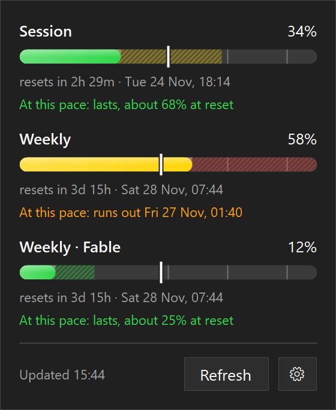

<p align="center"></p>

# Claude Usage Bar

[](https://github.com/LeoFalco/claude-usage-bar/actions/workflows/ci.yml)

A tiny macOS menu bar app, and [Windows tray app](#windows), that shows your Claude plan usage, the same numbers as `/usage` in Claude Code.

<p align="center"></p>

The menu bar shows `✳︎` followed by the highest session % and the highest weekly %. Click it for the panel:

- one bar per limit, orange at 70% and red at 90%;
- the countdown and the exact date and time each limit resets;
- **pace projection**: if usage keeps the average pace it has had since the window started, whether the limit lasts until reset, and roughly where it ends, or the date and time it runs out. It waits until 5% of the window has passed before guessing;
- refresh every 5 minutes, or right away with Refresh, ⌘R;
- the gear menu holds Open at login and Quit, ⌘Q.

### Alerts

- **Menu bar**: when a limit's pace runs out before its reset, `✳︎` turns into `⚠︎` in orange; from 90% used it turns red. Otherwise it stays monochrome like the other menu bar icons.
- **Notifications**: a macOS notification when a limit's pace runs out before reset, and another when it passes 90%. Each is sent once per limit window, also across restarts. macOS asks for permission the first time.

## Install

```bash
curl -fsSL https://raw.githubusercontent.com/LeoFalco/claude-usage-bar/main/install.sh | bash
```

It downloads the latest release into `/Applications`, clears the quarantine flag, since the app is not notarized, and opens it. On first launch the app adds itself to Login Items, so it starts with your Mac; turn that off in the gear menu.

To install by hand, download `ClaudeUsageBar.zip` from the [latest release](https://github.com/LeoFalco/claude-usage-bar/releases/latest), move the app to `/Applications` and run `xattr -dr com.apple.quarantine /Applications/ClaudeUsageBar.app`.

Requires macOS 13+ and [Claude Code](https://docs.claude.com/en/docs/claude-code) logged in with a Claude subscription (`claude` then `/login`).

## Windows

<p align="center"> </p>

The same app for the Windows system tray, with the same panel, pace projection and alerts:

- the tray icon shows an orange `✳︎` above the session %. The number turns yellow from 50%, orange from 70% and red from 90%;
- hover the icon for a card with a progress bar per limit; click it for the full panel. Bars go green, yellow, orange and red at 50, 70 and 90%;
- each bar also shows where the current pace ends at reset (hatched), ticks at 50, 70 and 90%, and a white marker for how much of the window has passed: a fill left of the marker means you are using less than an even pace;
- in the panel, Refresh is also Ctrl+R and Quit Ctrl+Q. Right-click the icon for Refresh, Open at login and Quit;
- alerts arrive as Windows notifications, once per limit window, also across restarts;
- open at login uses the per-user `Run` registry key, so it needs no admin rights. The app turns it on at first launch.

Install it from PowerShell:

```powershell
irm https://raw.githubusercontent.com/LeoFalco/claude-usage-bar/main/windows/install.ps1 | iex
```

It downloads the latest release into `%LOCALAPPDATA%\Programs\ClaudeUsageBar` and opens it. The exe is self-contained, so no .NET install is needed. It is not code-signed, so the installer clears the downloaded-file mark to keep SmartScreen quiet. Windows may hide new tray icons under the `^` overflow: drag it onto the taskbar to keep it in sight.

To install by hand, download `ClaudeUsageBar-windows-x64.zip` (or `-arm64`) from the [latest release](https://github.com/LeoFalco/claude-usage-bar/releases/latest), unzip it anywhere and run `ClaudeUsageBar.exe`.

Requires Windows 10 or 11 and Claude Code logged in with a Claude subscription. On Windows, Claude Code keeps its credentials in `%USERPROFILE%\.claude\.credentials.json` (or under `CLAUDE_CONFIG_DIR`), and the app reads the token from there.

## How it works

Claude Code stores its OAuth credentials in your login Keychain (item `Claude Code-credentials`). The app reads the access token with `/usr/bin/security` and calls the same endpoint `/usage` uses (on Windows the token comes from `.credentials.json`):

```
GET https://api.anthropic.com/api/oauth/usage
Authorization: Bearer <token>
anthropic-beta: oauth-2025-04-20
```

The token never leaves your machine except in that request to Anthropic. The app does not refresh the token itself: if it shows "Token expired", run Claude Code once.

This endpoint is undocumented and may change; the app reads the `limits` list and falls back to the older `five_hour` and `seven_day` fields.

## Build from source

```bash
swift test                 # needs Xcode (XCTest)
scripts/bundle.sh          # builds dist/ClaudeUsageBar.app for this Mac
scripts/bundle.sh --arch arm64 --arch x86_64   # universal build (needs Xcode)
open dist/ClaudeUsageBar.app
swift scripts/make-icon.swift                  # redraws Resources/AppIcon.icns and docs/icon.png
swift build && .build/debug/ClaudeUsageBar --snapshot docs/screenshot.png   # redraws the screenshot with sample data
```

On Windows, with the [.NET 10 SDK](https://dotnet.microsoft.com/download):

```powershell
dotnet test windows/UsageCore.Tests        # the same tests as Tests/UsageCoreTests, ported
pwsh windows/build.ps1                     # builds dist/windows/ClaudeUsageBar.exe and dist/ClaudeUsageBar-windows-x64.zip
dotnet run --project windows/ClaudeUsageBar -- --snapshot docs/screenshot-windows.png   # redraws the Windows screenshot
dotnet run --project windows/ClaudeUsageBar -- --snapshot-hover docs/screenshot-windows-hover.png   # redraws the hover card
pwsh windows/make-ico.ps1                  # rebuilds the Windows icon from docs/icon.png
```

`windows/UsageCore/Usage.cs` is a port of `Sources/UsageCore/Usage.swift`: change both together.

## Releases

CI runs tests and builds the macOS and Windows apps on every push to main and on every pull request. Pushing a tag `vX.Y.Z` builds a universal macOS app plus the Windows x64 and arm64 apps, and publishes them as a GitHub release.

## License

MIT. Not affiliated with Anthropic.
